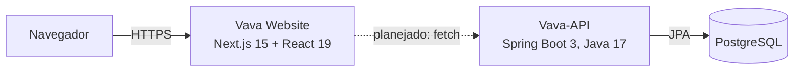

<p align="center">
  <!-- Quando tiver o logo, salve em docs/images/logo.png e descomente a linha abaixo -->
  <!--  -->
</p>

<h1 align="center">Vava Helper<br><sub><sup>Website</sup></sub></h1>

<p align="center">
  <b>Tudo sobre Valorant para jogadores iniciantes ou experientes.</b><br>
  Interface web do ecossistema Vava Helper: agentes, skills e lineups em um só lugar, consumindo a <a href="https://github.com/KairoLab/Vava-API">Vava-API</a>.
</p>

<p align="center">
  
  
  
  
  
  
  
</p>

<p align="center">
  <a href="#como-rodar">Como rodar</a> ·
  <a href="#telas">Telas</a> ·
  <a href="#arquitetura">Arquitetura</a> ·
  <a href="#como-contribuir">Contribuir</a> ·
  <a href="#roadmap">Roadmap</a> ·
  <a href="#licença">Licença</a>
</p>

<!-- Quando tiver uma captura da home, salve em docs/images/tela-home.png e descomente:
<p align="center">
  
</p>
-->

---

> **Status: em desenvolvimento inicial.** A base do projeto (Next.js, TypeScript, Tailwind, CI e padrões de contribuição) está pronta. As telas estão sendo construídas, e este README cresce junto com elas.

## Sumário

- [Visão geral](#visão-geral)
- [Telas](#telas)
- [Arquitetura](#arquitetura)
- [Como rodar](#como-rodar)
- [Scripts](#scripts)
- [Estrutura do projeto](#estrutura-do-projeto)
- [Integração contínua](#integração-contínua)
- [Como contribuir](#como-contribuir)
- [Roadmap](#roadmap)
- [Documentações úteis](#documentações-úteis)
- [Projetos relacionados](#projetos-relacionados)
- [Contribuidores](#contribuidores)
- [Licença](#licença)

## Visão geral

O Vava Helper nasceu para reunir, em português, o que um jogador de Valorant precisa consultar: quem são os agentes, o que cada skill faz e onde jogar cada lineup em cada mapa. Este repositório é o **site**. Os dados vêm da [Vava-API](https://github.com/KairoLab/Vava-API), um serviço separado.

| | Situação | O que é |
|---|:---:|---|
| **Base Next.js 15** | Pronto | App Router, React 19 e TypeScript, com `lang="pt-BR"` e metadados de SEO configurados |
| **Estilo com Tailwind** | Pronto | Tailwind CSS 3.4 com PostCSS e tokens de cor `background` e `foreground` |
| **Qualidade de código** | Pronto | ESLint 9 com a configuração do Next.js |
| **Integração contínua** | Pronto | Build no GitHub Actions em Node 20 e 22, revisão de dependências nos pull requests e `Jenkinsfile` |
| **Padrões de equipe** | Pronto | Conventional Commits e template de pull request |
| **Catálogo de agentes** | Planejado | Lista e página de cada agente, com skills e função |
| **Lineups** | Planejado | Vídeos filtrados por agente e por mapa |
| **Conta de usuário** | Planejado | Cadastro, login e recuperação de senha pelas rotas `/auth` da API |

## Telas

As telas entram aqui assim que a interface existir. O modelo abaixo segue o padrão dos outros projetos: uma tabela de duas colunas, com a imagem em cima e uma legenda curta embaixo.

<!--
Para ativar: salve os prints em docs/images/ (PNG, de preferência 1280 px de largura),
apague este comentário e ajuste os nomes dos arquivos.

| | |
|---|---|
|  |  |
| **Início**: busca e lista de agentes. | **Agente**: função, descrição e skills. |
|  |  |
| **Lineups**: vídeos por agente e por mapa. | **Conta**: login e cadastro. |

Versão mobile, em uma imagem só:

<p align="center">
  
</p>
-->

> Ainda não há capturas de tela porque a página inicial hoje mostra apenas o título do projeto.

## Arquitetura



| Camada | Tecnologia | Responsabilidade |
|---|---|---|
| Site | Next.js 15 (App Router), React 19, TypeScript, Tailwind CSS | Páginas, navegação e interface |
| API | Spring Boot 3, JWT, Caffeine | Catálogo público (agentes, skills e lineups) e autenticação. Veja o [README da Vava-API](https://github.com/KairoLab/Vava-API) |
| Banco | PostgreSQL | Fonte dos dados, acessado só pela API |

O site nunca fala com o banco. Tudo passa pela API, que cuida de cache, limite de requisições e segurança.

## Como rodar

### Requisitos

- [Node.js](https://nodejs.org/pt) 20 ou 22 (as versões testadas no CI)
- [pnpm](https://pnpm.io/pt/installation)
- [Git](https://git-scm.com/downloads)

### Passo a passo

```bash
# 1. clonar
git clone https://github.com/VavaHelper/website
cd website

# 2. instalar o pnpm, caso ainda não tenha
npm install --global pnpm

# 3. instalar as dependências
pnpm install

# 4. subir o servidor de desenvolvimento
pnpm dev
```

Abra **http://localhost:3000** no navegador. O servidor usa o Turbopack e recarrega sozinho a cada alteração.

> Se o Git pedir `user.name` e `user.email`, configure com `git config user.name "seu-nome"` e `git config user.email "seu@email.com"` e tente o clone de novo.

## Scripts

| Comando | O que faz |
|---|---|
| `pnpm dev` | Servidor de desenvolvimento com Turbopack em `localhost:3000` |
| `pnpm build` | Build de produção |
| `pnpm start` | Serve o build de produção (rode `pnpm build` antes) |
| `pnpm lint` | Verifica o código com ESLint |

## Estrutura do projeto

```text
src/
  app/
    layout.tsx        layout raiz: idioma pt-BR e metadados do site
    page.tsx          página inicial
    globals.css       diretivas do Tailwind e estilos globais
.github/
  workflows/          build (Node 20 e 22) e revisão de dependências
  PULL_REQUEST_TEMPLATE.md
Jenkinsfile           pipeline de instalação e build
tailwind.config.ts    conteúdo analisado e tokens de cor
next.config.ts        configuração do Next.js
```

## Integração contínua

| Pipeline | Quando roda | O que faz |
|---|---|---|
| **Node.js Building CI** (GitHub Actions) | Push e pull request na branch `development` | Instala com pnpm e roda `pnpm build` em Node 20.x e 22.x |
| **Dependency review** (GitHub Actions) | Pull request na branch `development` | Avisa no próprio PR se uma dependência nova tem vulnerabilidade conhecida |
| **Jenkinsfile** | Sob demanda, em agente Windows | Executa `npm install` e `npm run build` |

## Como contribuir

1. Crie uma branch a partir da `development`, que é a branch base do projeto.
2. Faça commits no padrão [Conventional Commits](https://www.conventionalcommits.org/pt-br/v1.0.0/), por exemplo `feat: adiciona lista de agentes` ou `fix: corrige link do menu`.
3. Rode `pnpm lint` e `pnpm build` antes de enviar.
4. Abra um pull request e preencha o template. Ele pede a descrição e o tipo da mudança:

   | Tipo | Quando usar |
   |---|---|
   | New Feature | Funcionalidade nova que não quebra as anteriores |
   | Bug fix | Correção de bug |
   | Breaking change | Mudança que pode quebrar algo existente |
   | Code refactor | Refatoração de código existente |
   | Build configuration change | Mudança em arquivos de configuração |
   | Documentation | Mudança na documentação |
   | Chore | Mudança em arquivos que não são código |

5. Mudou algo visível? Atualize as capturas em `docs/images`.
6. Quando o trabalho for feito em dupla, inclua `Co-authored-by:` no commit para que as duas pessoas recebam o crédito.

Em caso de dúvida, converse com o resto da equipe.

## Roadmap

- [x] Projeto Next.js 15 com TypeScript, Tailwind e ESLint
- [x] CI com build em Node 20 e 22 e revisão de dependências
- [x] Template de pull request e padrão de commits
- [ ] Identidade visual, tema claro e escuro e layout base com menu
- [ ] Página inicial com a lista de agentes (`GET /agents`)
- [ ] Página de agente com skills (`GET /agents/{name}/with-skills`)
- [ ] Lineups por agente e por mapa (`GET /media/agents/{name}` e `GET /media/maps/{mapName}`)
- [ ] Cadastro, login e recuperação de senha (`/auth/*`)
- [ ] Testes automatizados e deploy

## Documentações úteis

- [Next.js](https://nextjs.org/docs): recursos e API do framework
- [React](https://react.dev/learn): componentes, estado e reatividade
- [Tailwind CSS](https://tailwindcss.com/docs/): estilo por classes utilitárias
- [Conventional Commits](https://www.conventionalcommits.org/pt-br/v1.0.0/): padrão de mensagens de commit

## Projetos relacionados

| Projeto | O que é |
|---|---|
| [Vava-API](https://github.com/KairoLab/Vava-API) | API REST em Spring Boot com agentes, skills, lineups e autenticação JWT |

## Contribuidores

<a href="https://github.com/VavaHelper/website/graphs/contributors">
  
</a>

## Licença

Copyright (c) 2025 VavaHelper

Este projeto é distribuído sob a licença [MIT](LICENSE.txt). Você pode usar, copiar, modificar e redistribuir o código, desde que mantenha o aviso de copyright e o texto da licença.

Vava Helper é um projeto de fãs e não tem relação com a Riot Games. Valorant e os nomes de agentes e mapas pertencem à Riot Games.
